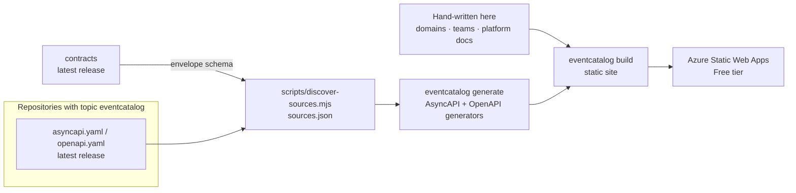

# eventcatalog

The architecture catalog of the
[AI Intelligence Domain demo](https://github.com/azure-intelligence-domain/ai-intelligence-domain):
every domain, service, API, event and owner of the integration platform, built with
[EventCatalog](https://www.eventcatalog.dev/). Owned by the **platform team**.

**Nothing about services is written by hand here.** The catalog is generated from the released
contracts in each repository (decision:
[ADR 0009](https://github.com/azure-intelligence-domain/ai-intelligence-domain/blob/main/docs/adr/0009-eventcatalog-generated-from-contracts.md)).



| Folder | Content | Written by |
|---|---|---|
| `domains/<id>/index.mdx` | The business domains of the talk, plus the platform | hand |
| `domains/<id>/services/` | Services, APIs and messages | generated (not committed) |
| `teams/` | Domain teams and the platform team (owners) | hand |
| `docs/platform/` | The envelope, contracts and rules, how to get cataloged | hand (the envelope schema is fetched) |
| `scripts/discover-sources.mjs` | Finds released contracts in the organisation | — |
| `tests/` | End-to-end: released contracts become the right catalog | — |

## How a service gets in

1. Its contract is in the repository root: `asyncapi.yaml` and/or `openapi.yaml`.
2. Its repository has the GitHub topic `eventcatalog`.
3. It has a GitHub release. Only the latest release is cataloged.

The domain comes from the contract (AsyncAPI `id` or OpenAPI title), the owner is that domain's
team. The catalog rebuilds daily and on every change here.

## Development

```bash
npm ci
GITHUB_TOKEN=$(gh auth token) npm run discover   # sources.json + envelope schema
npx eventcatalog generate && npm run dev         # http://localhost:3000
npm test                                         # end-to-end generation tests
```

## Licence

The content of this repository is MIT-licensed. EventCatalog itself (`@eventcatalog/core` 5.x) is
licensed under the Business Source License 1.1; this catalog qualifies for Free Use because it
documents a public open-source project and is hosted without charge (see ADR 0009). The
generators are MIT.
