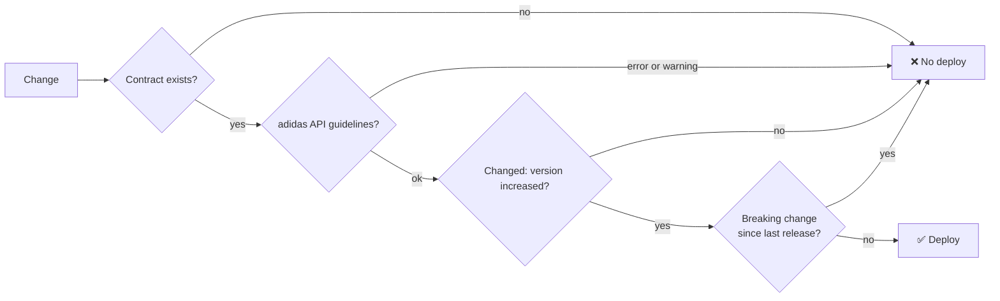

Every interface on the platform has a contract, internal ones included:

- **OpenAPI** for every HTTP interface: Experience, Process and System APIs.
- **AsyncAPI** for every event: the producer's contract owns the message (`publish`), each
  consumer declares what it receives in its own contract (`subscribe`).

The contract lives in the repository of the building block that implements it, and is written
before the code.

## The rules

All contracts follow the [adidas API guidelines](https://github.com/adidas/api-guidelines),
enforced by Spectral. The platform's adaptations, each with its reason, are in
[ADR 0008](https://github.com/azure-intelligence-domain/ai-intelligence-domain/blob/main/docs/adr/0008-adidas-api-guidelines.md).

| Topic | Rule |
|---|---|
| Naming | camelCase fields; kebab-case paths; API names like `[Sales] Orders System API`; channels like `supply.wms.event.stock-reserved` |
| Data types | ISO 8601 in UTC, ISO 4217 currencies, ISO 3166 countries; no `null` values |
| Responses | HAL (`application/hal+json`) for success, Problem Details (`application/problem+json`) for errors |
| Versioning | Semantic versions; no version in URIs; released versions never change |
| Journey | Every operation accepts `Correlation-Id`; every event uses the envelope |
| Ownership | Producers list themselves in `x-producers`, consumers in `x-consumers` |

## No contract, no deploy

Every repository runs the reusable contract check before it deploys:

A breaking change follows the adidas rules for extending: anything removed, anything made
required, or any changed type or constraint. Such a change becomes a new event type on a new
channel, or a new resource variant, never a change to the existing one.
