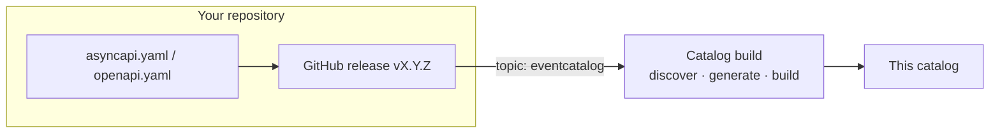

The catalog is generated from the contracts in each repository. To appear:

1. Put your contract in the root of your repository: `asyncapi.yaml` (events) and/or
   `openapi.yaml` (REST).
2. Give your repository the GitHub topic **`eventcatalog`**.
3. Release a version: tag it and publish a GitHub release.

The catalog is rebuilt every day and on every change to this repository. It picks up the
**latest release** of every repository, so work in progress never shows up.

## Where your service lands

Everything is read from the contract, using conventions the contract check already enforces:

| What | Read from |
|---|---|
| Domain | The AsyncAPI `id` (`urn:azure-intelligence-domain:<domain>:<name>`) or the OpenAPI title (`[Domain] Name API`) |
| Owner | The domain's team, `<domain>-team` |
| Events you send | `publish` operations in your AsyncAPI contract |
| Events you receive | `subscribe` operations in your AsyncAPI contract |
| Endpoints | Your OpenAPI contract |

Start from the templates in the
[contracts](https://github.com/azure-intelligence-domain/contracts/tree/main/templates)
repository.
