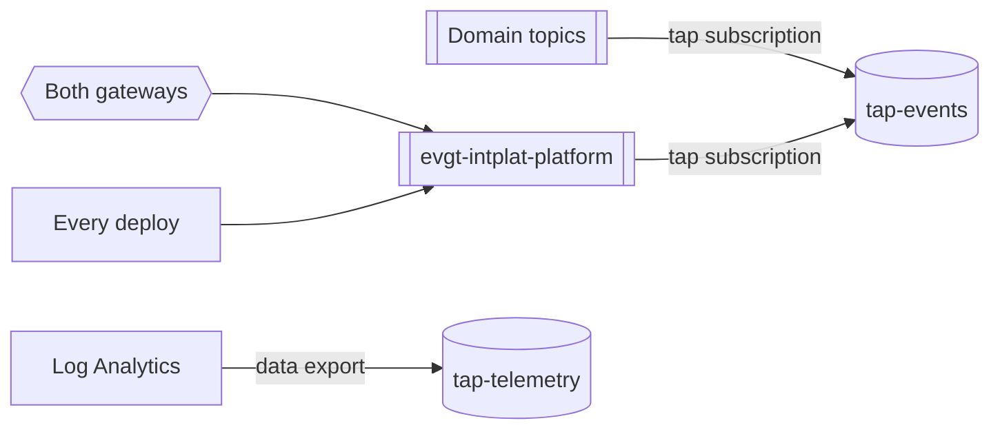

> A tap on everything: every topic mirrored to the Intelligence domain. Subscribe by default.

| What happens | Captured as | Lands in |
|---|---|---|
| A business event on any domain topic | the event itself | <Link href="/docs/channels/tap-events/1.0.0">tap-events</Link> |
| A mutation through the people gateway | `com.acme.platform.gateway.mutation` | tap-events |
| Any call through the agent gateway | `com.acme.platform.agent.action` | tap-events |
| A deployment of any building block | `com.acme.platform.deployment.completed` | tap-events |
| Every API call, dependency, error; Event Grid and Service Bus logs | telemetry | <Link href="/docs/channels/tap-telemetry/1.0.0">tap-telemetry</Link> |

The tap lives in its own resource group that the kill switch never deletes, so the history from
the first building block on is kept until the Intelligence domain reads it (phase 2). Every
platform deploy proves it: a probe on every topic, a mutation and two agent actions must arrive.
