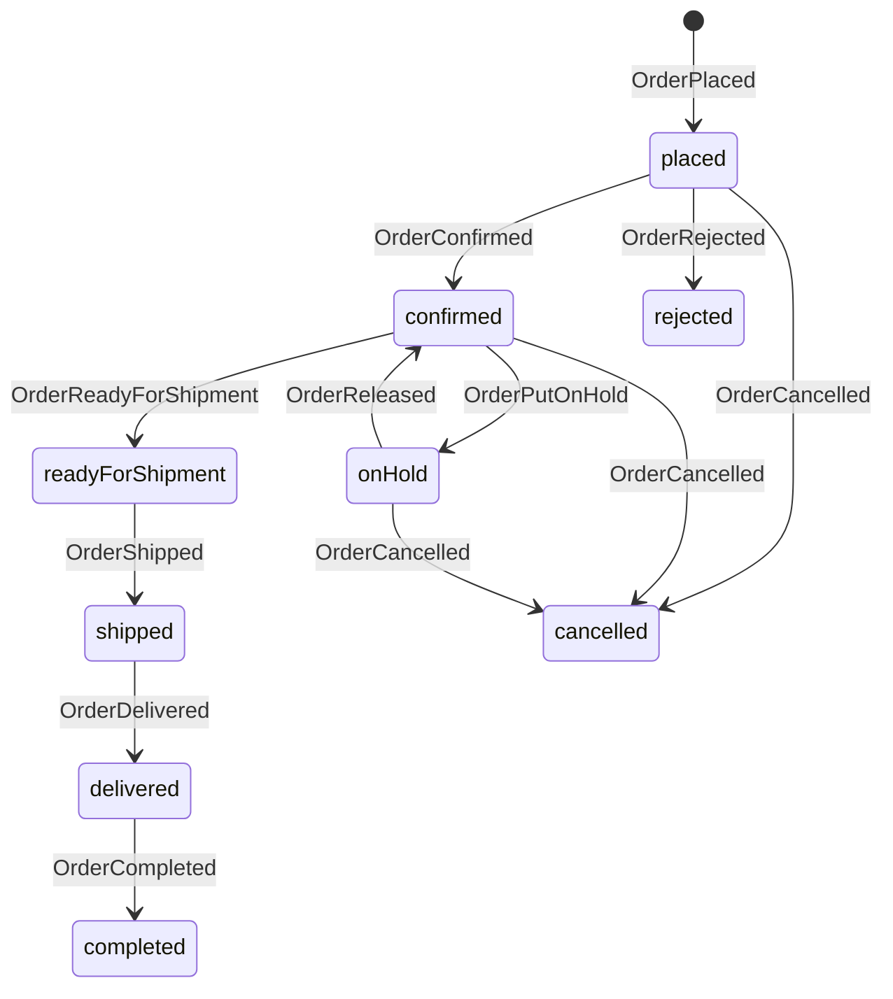
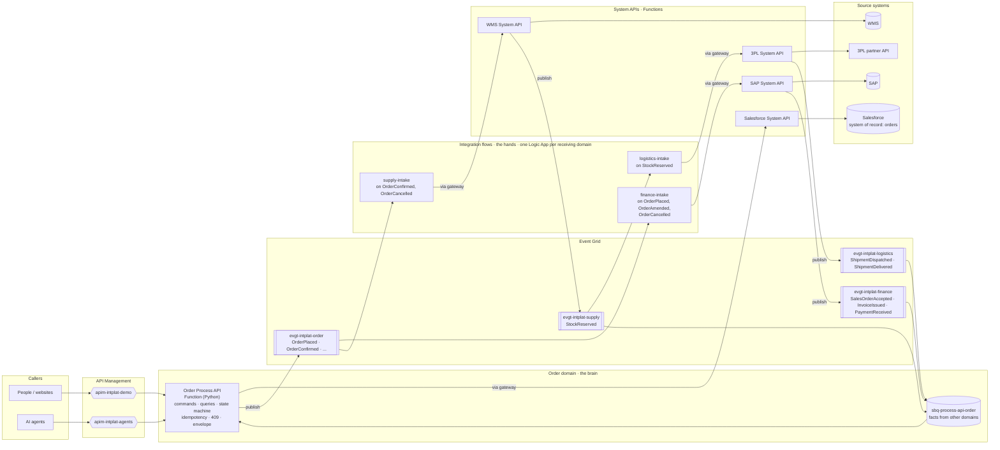

import BpmnViewer from '@catalog/components/bpmn-viewer.astro';

## Overview

The order domain owns the journey of ACME's order 4711 from the talk: every system knows its part,
the order domain knows the story. It speaks in business facts, never in CRUD: an order is placed,
amended, rescheduled, put on hold or cancelled; it is never updated or deleted.

| Command | Event |
|---|---|
| Place Order | OrderPlaced |
| Amend Order Lines | OrderAmended |
| Change Delivery Address | OrderDeliveryAddressChanged |
| Reschedule Delivery | OrderDeliveryRescheduled |
| Put Order on Hold / Release Order | OrderPutOnHold / OrderReleased |
| Cancel Order (soft delete) | OrderCancelled |

Policies turn other domains' facts into order facts: the ERP's decision into OrderConfirmed or
OrderRejected, finance's InvoiceIssued and PaymentReceived into OrderInvoiced and OrderPaid,
supply's StockReserved into OrderReadyForShipment, logistics' dispatch and delivery into
OrderShipped and OrderDelivered. When an order is delivered and paid, it is OrderCompleted.

Every retrieval of an order or a list of orders is tapped with orderid or customerid, so the
Intelligence domain can see how often orders are looked at, and by whom.

## Order status

Payment status is separate (`unpaid`, `invoiced`, `paid`): an order can be shipped and still unpaid.

## The brain and the hands

The Order Process API (Function) decides; Logic Apps move data between systems.

## Order to delivery

<BpmnViewer file="bpmn/process-api-order/order-to-delivery.bpmn" title="Order to delivery (BPMN 2.0)" height={520} />

The command and query flows are on the <Link href="/docs/custom/order/01-order-flows">order flows</Link> page.

## Data model

The order as the order domain sees it: one aggregate, the **Order**, with its lines and two value objects. Salesforce keeps it (system of record); the customer and the product belong to the sales domain.

<EntityMap id="order" />
