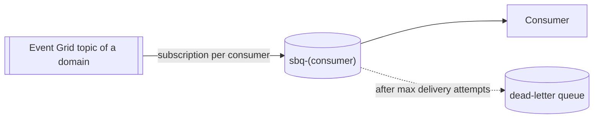

## Overview

Every consumer of events owns one queue in this namespace, fed by an Event Grid subscription on
the event types it declared in its own AsyncAPI contract. Each queue has its own dead-letter
queue: this is where the shipment requests of the ACME 4711 story end up after deployment v2.4.

| Property | Value |
|---|---|
| Resource | `sbns-intplat-demo`, Belgium Central, Basic tier |
| Queues | `sbq-<consumer>`, one per consuming building block (added with each consumer) |
| Authentication | Microsoft Entra ID only (local auth disabled). Consumers need the Azure Service Bus Data Receiver role on their own queue. |
| Diagnostics | Operational logs to Log Analytics |

