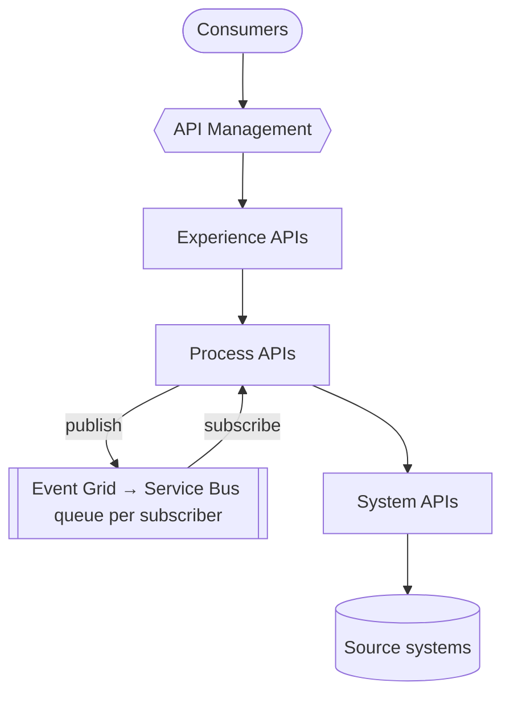

## Overview

The integration platform carries every hand-off between the business domains. No point-to-point
shortcuts: if two systems exchange something, the platform sees it. That is what makes the
Intelligence domain possible later.

It is built API-led:

## What the platform guarantees

| Guarantee | How |
|---|---|
| Every event carries its context | The [envelope](/docs/custom/platform/01-the-envelope): CloudEvents + `correlationid` + business keys |
| Every interface has a contract | OpenAPI and AsyncAPI, checked against the [adidas API guidelines](/docs/custom/platform/02-contracts-and-rules) |
| No breaking changes | The contract check compares every change with the last release |
| Everything is cataloged | Released contracts appear here automatically ([how](/docs/custom/platform/03-add-your-service)) |
